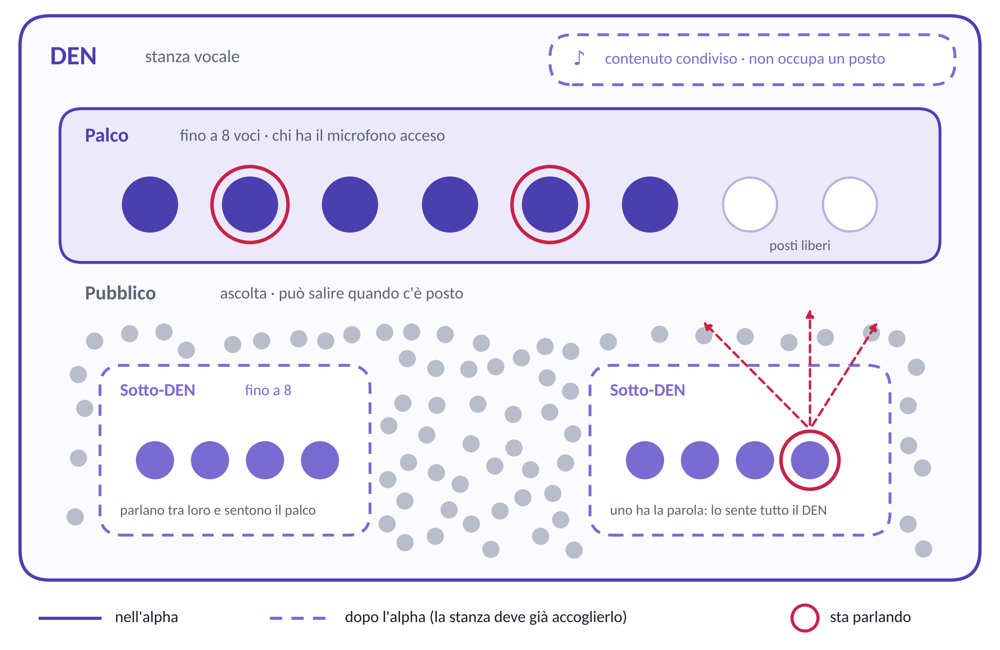
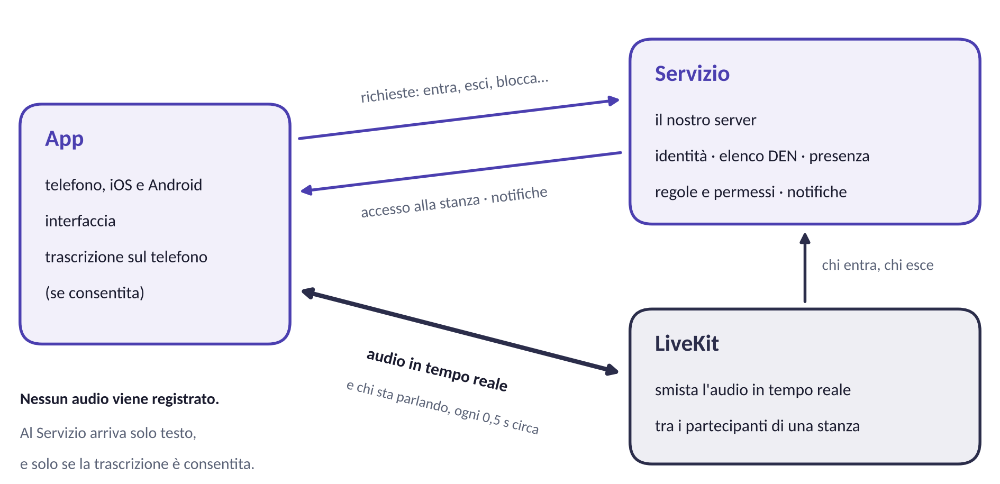

**BA — Guida per il prototipatore**

Studio preliminare, wireframe e prototipo

Documento riservato · ottobre 2026

**Come usare questo documento.** Raccoglie ciò che serve per partire: cos'è BA, il vocabolario, i principi di design, il modello del prodotto, cosa prototipare e con quali priorità, i vincoli tecnici che toccano l'interfaccia e cosa ci aspettiamo in uscita. Le sezioni 1–3 vanno lette prima di iniziare; le altre servono come riferimento durante il lavoro.

Allegato: *Brief di design (UI/UX)*, che approfondisce stati e domande di design.

**1. BA in breve**

BA è un social **vocale** basato sulla presenza. Le persone entrano in **DEN**: stanze vocali dove un **palco di massimo 8 persone** parla e un pubblico ascolta. Chi ascolta può salire sul palco quando c'è posto.

Il claim è **"La Live sei tu"**: la live non è il contenuto, è chi lo vive insieme. Una conversazione, una puntata di podcast, un disco diventano "live" nel momento in cui li si ascolta con altre persone e se ne parla adesso. **Conta la co-presenza, non la sorgente.**

Tre scelte lo distinguono:

- **Si parla, non si scrive.** Nelle stanze non esiste chat testuale. Si agisce con azioni dirette: entra, sali, alza la mano.

- **È effimero.** Nessuna conversazione viene registrata o riascoltata. Niente feed, like o archivio.

- **Il pubblico conta quanto il palco.** Chi ascolta può parlare con altri in piccoli gruppi mentre ascolta.

**Da dove nasce.** Le community attorno a podcast, creator e passioni esistono già, ma vivono su Telegram e Discord e comunicano per iscritto. Il bisogno di stare insieme attorno a un contenuto c'è; manca il posto, e manca la voce. I primi utenti a cui pensiamo vengono da lì: le community dei podcast italiani, il mondo della stand-up comedy, i creator audio.

**2. Glossario**

Usa questi termini anche nei nomi di schermate e stati. Sono gli stessi del codice: un vocabolario comune evita fraintendimenti tra prototipo e sviluppo.

| **Termine**           | **Significato**                                                                                                                                                                                              |
|-----------------------|--------------------------------------------------------------------------------------------------------------------------------------------------------------------------------------------------------------|
| **DEN**               | Stanza vocale. Può essere pubblica, privata o di un creator.                                                                                                                                                 |
| **Palco**             | Chi può parlare nel DEN. Massimo 8 persone.                                                                                                                                                                  |
| **Pubblico**          | Chi è nel DEN e ascolta. Nessun limite di numero.                                                                                                                                                            |
| **Sotto-DEN**         | Gruppo di massimo 8 persone dentro un DEN, che sente il DEN principale e intanto parla al proprio interno. Nei documenti più vecchi si chiama *Loggia*, nome di lavoro non definitivo.                       |
| **Coda**              | Lista d'attesa per salire sul palco quando è pieno.                                                                                                                                                          |
| **Parola**            | Permesso, concesso da un creator, di parlare a tutto il DEN restando nel pubblico o nel proprio sotto-DEN. Come se dal palco passassero un microfono tra il pubblico.                                        |
| **Alzata di mano**    | Richiesta della parola.                                                                                                                                                                                      |
| **Ingresso morbido**  | Si entra in un DEN senza essere annunciati.                                                                                                                                                                  |
| **Muta una voce**     | Smetto di sentire una persona, solo per me. Gli altri continuano a sentirla, e lei non lo sa.                                                                                                                |
| **Blocco**            | Relazione persistente tra due persone. Chi è bloccato non vede i DEN di chi l'ha bloccato e non può entrarci; altrove viene mutato automaticamente per chi l'ha bloccato.                                    |
| **DEN vuoto**         | DEN senza nessuno dentro. Si può restare in attesa per essere avvisati quando arriva qualcuno.                                                                                                               |
| **Ascolto condiviso** | Un contenuto, per esempio una puntata di podcast, riprodotto nella stanza come se fosse un partecipante. Lo sentono tutti, si abbassa automaticamente quando qualcuno parla e non occupa un posto sul palco. |
| **Creator**           | Utente con funzioni di conduzione: pubblico organizzato, parola da concedere, DEN programmati, persone che lo seguono.                                                                                       |
| **DEN programmato**   | DEN di un creator con un orario di inizio. Esiste prima di essere attivo, e chi segue il creator può mettersi in attesa.                                                                                     |
| **Alpha / Beta**      | Alpha: prima versione, per test interni. Beta: test allargato con le funzioni sociali complete.                                                                                                              |

**3. Principi di design**

Quattro principi da cui discende quasi tutto il resto. Prevalgono su qualsiasi dettaglio di questo documento.

**L'app è per lo più non guardata.** Si usa a schermo spento, in tasca, camminando, al buio a letto, mentre si fa altro. L'interfaccia deve rendere leggibile la presenza in mezzo secondo e poi sparire. Per questo gli stati critici, come microfono aperto o chiuso e chi ti sente, non possono affidarsi solo alla vista: **suono e vibrazione fanno parte del design**.

**Il pubblico è il contenuto.** Non c'è una star al centro. Palco e pubblico si distinguono per funzione, cioè per chi ha il microfono acceso, non per status. Il design non crea un podio e non fa sentire chi ascolta una comparsa. Vale anche per chi paga: un abbonato è attrezzato meglio, non è superiore.

**Il tempo dell'app è solo adesso.** Niente cronologie, archivi, badge accumulativi, contatori in evidenza o serie di giorni consecutivi. L'unica eccezione sono i DEN programmati, che guardano avanti verso un appuntamento.

**L'ingresso è morbido.** Nessun suono, nessuna animazione trionfale, nessun "X è entrato". Si arriva come si entra in una stanza di casa.

**Cosa BA non deve sembrare**

- **Clubhouse.** Simile in superficie (stanze, palco, mani alzate) ma costruita sullo status. È il confronto da cui distinguersi con più attenzione.

- **Twitch e il broadcast.** Un emittente e un pubblico passivo. In BA il pubblico è metà del punto.

- **Discord.** Lì il testo è primario; in BA è assente.

- **Spotify e simili.** Lì il contenuto è protagonista; in BA è un pretesto per stare insieme.

**Cosa è deciso e cosa è aperto**

**Deciso, da non riprogettare:**

- solo voce: nessuna chat testuale nelle stanze;

- nessun audio registrato;

- ingresso morbido;

- palco di massimo 8 persone;

- nessuna gerarchia di status, nemmeno a pagamento, e nessuna precedenza in coda acquistabile;

- "muta una voce" è personale e invisibile agli altri;

- accesso solo con numero di telefono, senza login Google o Apple;

- due consensi separati in registrazione;

- tema scuro come tema principale.

**Aperto, ed è il tuo terreno:** come si vede chi parla; come si risponde a "chi mi sente adesso"; come si rappresenta una persona senza foto; come si rende invitante un DEN vuoto; layout della stanza, navigazione e gerarchia visiva; tono dell'onboarding e dei consensi; identità sonora e aptica; come comunicare onestamente cosa resta e cosa no; microinterazioni e movimento.

Se lo studio porta evidenze contro una decisione della prima lista, **portacele** e ne discutiamo. Non progettare per aggirarla.

**4. Il modello del prodotto**

**Esiste una sola struttura:** una stanza vocale con al massimo 8 persone che parlano. I diversi tipi di DEN sono configurazioni della stessa struttura.

| **Tipo**         | **Chi lo gestisce**                                 | **Pubblico**                    | **Come si entra**                               |
|------------------|-----------------------------------------------------|---------------------------------|-------------------------------------------------|
| **DEN pubblico** | Nessuno: non ci sono amministratori                 | Sì                              | Libero; se il palco è pieno, in coda            |
| **DEN privato**  | Chi l'ha creato, più eventuali altri amministratori | No: sono tutti sul palco        | Solo su invito                                  |
| **Sotto-DEN**    | Come sopra, secondo se è pubblico o privato         | No                              | Pubblico: chiunque fino a 8. Privato: su invito |
| **DEN creator**  | Il creator                                          | Sì, anche organizzato in gruppi | Secondo configurazione                          |

Nella versione completa i DEN nascono anche in altri modi: proposti dal sistema sui temi del momento, "chiacchiere veloci" create con un tocco e senza argomento, oppure attorno a un contenuto come una puntata o una partita. Per il prototipo basta sapere che esistono.

*Il modello della stanza. Linea continua: presente nell'alpha. Tratteggio: arriva dopo, ma la stanza deve poterlo accogliere fin da subito.*

**La parola si aggiunge, non sposta**

Un creator può dare la parola a una persona del pubblico o a un intero sotto-DEN. Chi la riceve **non sale sul palco**: resta nel proprio gruppo, ma la sua voce si aggiunge al DEN. Da quel momento lo sentono il suo gruppo e tutti gli altri.

La conseguenza decisiva: **chi ha la parola perde il canale privato**. Per questo **il microfono è per stanza e non globale**. Chi ha la parola può abbassare il microfono pubblico e tornare a parlare solo al suo gruppo senza perdere il turno, come chi appoggia il microfono senza restituirlo. Gli stati udibili restano due: *mi sente il mio gruppo* oppure *mi sentono tutti*.

**Muta e blocca**

**Muta una voce** agisce solo sul tuo telefono: smetti di sentire quella persona, gli altri continuano a sentirla e lei non lo sa.

**Il blocco** è persistente. Chi è bloccato non vede i DEN di chi l'ha bloccato, non può entrarci e non può esservi invitato. Se i due si ritrovano nel DEN di una terza persona, il bloccato può entrare ma è mutato automaticamente per chi l'ha bloccato. Con un tocco quest'ultimo può tornare a sentirlo, **solo in quel DEN**, e la scelta resta memorizzata. Una lista dei bloccati, con la possibilità di sbloccare, si trova nelle impostazioni.

**Livelli di account**

| **Free**                                                                                               | **Pagante**                                                                                                                                                | **Creator**                                                                                                                                 |
|--------------------------------------------------------------------------------------------------------|------------------------------------------------------------------------------------------------------------------------------------------------------------|---------------------------------------------------------------------------------------------------------------------------------------------|
| Tutto l'essenziale: creare e frequentare DEN, parlare, mettersi in coda su più DEN, ricevere notifiche | In più: sotto-DEN mentre si è in coda, posto conservato se si esce un attimo, nessun limite di permanenza e nessuna pubblicità, qualora vengano introdotti | In più: DEN con pubblico organizzato, parola da concedere e togliere, DEN programmati, persone che lo seguono, trasmissione in alta qualità |

La regola: **si fa pagare la comodità e la capacità, mai la posizione rispetto a un'altra persona.** Nessuno scavalca nessuno in coda e nessuno appare superiore. L'alpha ha solo il livello free; prezzi e dettagli sono in definizione.

**Privacy: cosa resta e cosa no**

- **L'audio non viene mai registrato.**

- Se l'utente lo consente, le conversazioni vengono **trascritte sul telefono**. Al nostro server arriva solo testo, che viene analizzato per profilazione e moderazione e poi cancellato; restano solo i risultati dell'analisi.

- In registrazione ci sono **due consensi separati**: termini e privacy, necessario; trascrizione e profilazione, **rifiutabile**, perché l'app funziona anche senza.

Per il design questo significa che l'effimero vale per l'audio, non per tutto. L'interfaccia deve dirlo con onestà: chi scopre dopo che il testo viene trascritto perde fiducia in modo sproporzionato.

**5. Cosa prototipare**

L'**alpha** è una versione interna che serve a capire se l'esperienza funziona; la **beta** aggiunge le funzioni sociali complete. Il prototipo ha però un vantaggio che il codice non ha: **può simulare situazioni che l'alpha non è ancora in grado di produrre**, come un palco pieno o un sotto-DEN che riceve la parola. Per questo il suo perimetro è un po' più ampio di quello dell'alpha.

| **Priorità**                     | **Cosa**                                                                                                                                                                      | **Fedeltà**                                                            |
|----------------------------------|-------------------------------------------------------------------------------------------------------------------------------------------------------------------------------|------------------------------------------------------------------------|
| **1 · Alpha**                    | Accesso e consensi · elenco DEN · stanza (palco, pubblico, chi parla, sali e scendi, muta, blocca, esci) · DEN vuoto, attesa e notifica · impostazioni con lista dei bloccati | Completa, con tutti gli stati                                          |
| **2 · Ciò che decide il layout** | Coda verso il palco con ingresso a microfono spento · sotto-DEN · alzata di mano · parola e "chi mi sente adesso" · ascolto condiviso con volume personale                    | Media: quanto basta a provarli e a verificare che la stanza li accolga |
| **3 · Orizzonte**                | Creazione di DEN pubblici e privati con inviti · profilo creator, DEN programmati, persone che seguono · livelli di account · "disponibile a chiacchierare"                   | Schizzi                                                                |

**Parti dalla stanza DEN**: se funziona quella, il resto segue. Deve nascere già pronta ad accogliere la priorità 2, perché una stanza disegnata ignorando i sotto-DEN andrebbe rifatta da capo.

La coda non sarà nell'app alpha: con pochi tester il palco non si riempie mai, quindi non si potrebbe provare. Nel prototipo invece sì, ed è il momento giusto per farlo.

**I flussi principali**

**Primo accesso.** Numero di telefono, codice ricevuto via SMS, due consensi separati, eventuale nome o nickname (da decidere), elenco DEN. In futuro la verifica potrà avvenire senza codice, tramite l'operatore telefonico: il flusso deve funzionare anche se il passaggio del codice sparisce. Un passaggio sull'età minima è in definizione.

**Entrare in un DEN.** Si tocca un DEN, si entra nel pubblico e si comincia subito a sentire. Nessuno viene avvisato dell'arrivo. L'ingresso richiede in genere uno o due secondi, che vanno coperti.

**Salire sul palco.** Se c'è posto si sale, e si parla quando si attiva il microfono. Se il palco è pieno ci si mette in coda (priorità 2). Quando si libera un posto si viene avvisati e si sale **con il microfono spento**, da attivare a mano. L'opzione "fammi entrare automaticamente", valida per quel DEN e per quella sessione, occupa il posto senza conferma, ma il microfono resta comunque spento.

**DEN vuoto.** Si entra in un DEN senza nessuno, si può restare in attesa, e se si esce dall'app una notifica avvisa quando arriva qualcuno. Il tocco sulla notifica riporta nella stanza.

**Muta e blocca.** Dalla scheda di un partecipante: muta, solo per me e reversibile, oppure blocca, persistente. Lo sblocco avviene dalla lista nelle impostazioni.

**Ricevere la parola** (priorità 2). Sono nel mio sotto-DEN, alzo la mano, il creator mi dà la parola e ora mi sentono tutti. Posso abbassare il microfono pubblico per parlare solo al mio gruppo. Alla fine il creator mi toglie la parola.

**6. Gli stati**

In un'app di presenza il valore sta negli stati più che nelle schermate. Ogni stato va progettato esplicitamente: cosa si vede, cosa si sente, cosa vibra.

**Stati critici, dove un errore è un incidente e non un fastidio:**

- **"Chi mi sente adesso?"** È la domanda più importante dell'intero design. Il passaggio da "mi sente il mio gruppo" a "mi sentono tutti" deve essere percepibile senza guardare, e per tutta la sua durata. Se dopo trenta secondi ci si può dimenticare di avere la parola, il design non funziona.

- **Sul palco con il microfono spento.** Occupo il posto ma non trasmetto. Deve essere impossibile da fraintendere, anche con il telefono in tasca.

- **Ho ricevuto la parola**, e il suo opposto, **la parola mi è stata tolta**: chiaro, ma non umiliante.

- **Ho la parola ma ho abbassato il microfono pubblico.** Stesso permesso, ma a sentirmi è un pubblico diverso: è il punto esatto in cui ci si può sbagliare.

**Stati ordinari, da non dimenticare:**

- qualcuno parla; più persone parlano insieme (leggibile, senza diventare un albero di Natale); silenzio (sereno, non imbarazzante);

- **DEN vuoto**: nell'alpha sarà lo stato più frequente e la prima impressione di quasi ogni tester. Deve risultare invitante;

- da vuoto a vivo: qualcuno arriva mentre aspetti;

- in coda, anche su più DEN; ingresso automatico attivo; palco pieno;

- voce mutata da me; persona bloccata presente e mutata automaticamente;

- **posto appena preso da un altro**: due persone possono toccare "sali" quasi nello stesso istante, e una delle due riceve un rifiuto;

- connessione instabile o persa; permessi negati per microfono o notifiche;

- consenso alla profilazione rifiutato: cosa cambia, senza far sentire penalizzati.

**7. La tecnica, ad alto livello**

Non serve conoscere l'implementazione, ma alcuni fatti tecnici hanno conseguenze dirette sull'interfaccia.

*Le tre parti del sistema e cosa si scambiano.*

- **L'App** è un'unica base di codice in Flutter per iOS e Android.

- **Il Servizio** è il nostro server: identità, elenco dei DEN, regole e permessi, presenza, notifiche. Ciò che un'app manomessa non deve poter aggirare, come il limite di 8 o i blocchi, viene applicato qui.

- **LiveKit** è il server che smista l'audio in tempo reale tra i partecipanti di una stanza.

| **Fatto tecnico**                                                                                 | **Conseguenza per il design**                                                                                                                                                                                                                         |
|---------------------------------------------------------------------------------------------------|-------------------------------------------------------------------------------------------------------------------------------------------------------------------------------------------------------------------------------------------------------|
| L'informazione su chi sta parlando arriva circa ogni mezzo secondo, già mediata                   | L'indicatore va pensato per **stati** (parla / tace), non come misuratore di volume: un'onda che segue la voce andrebbe a scatti. Ordine di grandezza: comparsa rapida (120–150 ms), scomparsa più lenta (400–600 ms) per non sfarfallare nelle pause |
| L'ingresso in una stanza richiede uno o due secondi                                               | Serve uno stato di ingresso, sobrio come l'ingresso morbido                                                                                                                                                                                           |
| L'elenco dei DEN si aggiorna ogni pochi secondi                                                   | Un DEN mostrato come attivo può essersi svuotato nel frattempo: va previsto                                                                                                                                                                           |
| Le regole le applica il server                                                                    | Un'azione permessa dall'interfaccia può essere rifiutata (palco appena riempito): servono stati di rifiuto chiari                                                                                                                                     |
| "Muta una voce" avviene solo sul tuo telefono                                                     | Nessuno ne è informato: va presentato come preferenza personale                                                                                                                                                                                       |
| Dopo un'interruzione di rete la connessione si ristabilisce da sola                               | Servono stati di riconnessione, calmi                                                                                                                                                                                                                 |
| L'audio continua a schermo spento                                                                 | Su Android il sistema mostra una notifica fissa mentre si è in una stanza: è parte dell'esperienza e va progettata, con testo e azioni rapide                                                                                                         |
| Il sistema operativo segnala da solo il microfono in uso (per esempio il pallino colorato su iOS) | Interfaccia e sistema devono dire la stessa cosa. *Da verificare con lo sviluppo*: se l'indicatore di sistema resta acceso a microfono disattivato nell'app, l'utente può credere di trasmettere                                                      |
| Mentre gira l'audio in tempo reale, le animazioni continue consumano processore e batteria        | Movimento breve e mirato; nessuna animazione permanente su otto indicatori                                                                                                                                                                            |
| La trascrizione avviene sul telefono ed è disattivabile                                           | Serve un interruttore chiaro. Se e come segnalarla dentro la stanza è una domanda aperta                                                                                                                                                              |

**Vincoli per il design**

- **Prima il tema scuro**: l'uso è soprattutto serale e notturno.

- **Schermi piccoli**: il riferimento più stretto è un iPhone di oltre quattro anni.

- **Una mano**: azioni principali nella metà bassa dello schermo.

- **Cinque lingue** (italiano, inglese, francese, spagnolo, tedesco). Il tedesco allunga le etichette fino al 30%.

- **Accessibilità**: contrasto almeno AA, aree toccabili di almeno 44 pt, compatibilità con lo screen reader. Un'app basata sull'audio attira anche persone non vedenti.

- **Identità propria**, né Material né Cupertino, ma realizzabile con componenti standard.

- **Valori come scala.** Spaziature, dimensioni e durate confluiscono nel codice in un unico file di *design token*. Una scala coerente vale più di valori perfetti schermata per schermata.

**Dispositivi di prova:** un iPhone recente, un iPhone di oltre quattro anni, un Android di fascia media e uno di fascia alta. Il giudizio finale si dà su un telefono vero, non sullo schermo del computer.

**8. Lo studio preliminare**

L'obiettivo è verificare, prima di scrivere il codice dell'interfaccia, che il modello sia comprensibile e che l'esperienza di presenza funzioni. Metodo e strumenti li scegli tu; qui trovi le domande che ci interessano e qualche suggerimento.

**Le domande**

1.  **Il modello si capisce?** Palco, pubblico, sotto-DEN e parola sono chiari senza spiegazioni?

2.  **Come si entra in una conversazione tra sconosciuti?** Cosa rende facile, o imbarazzante, il primo ingresso e la prima volta che si parla?

3.  **Cosa fa sentire che c'è qualcuno**, senza video e senza testo?

4.  **Cosa fa restare in un DEN vuoto** invece di andarsene?

5.  **Chi mi sente adesso?** Le persone lo sanno sempre, anche con il telefono in tasca?

6.  **I controlli sono a portata di mano?** Mutare, bloccare e scendere dal palco sono rapidi e privi di imbarazzo?

7.  **La trascrizione, spiegata con onestà, viene accettata?** Come reagiscono le persone ai consensi?

**Riferimenti da analizzare**

- **Clubhouse**, esplosa nel 2021 e poi ridimensionata: cosa funzionava e perché le persone se ne sono andate.

- **X Spaces** e i **canali Stage di Discord**: come gestiscono palco, ascolto e mani alzate.

- **Stationhead**: ascolto condiviso con il proprio abbonamento musicale e una chat testuale. È il riferimento più vicino al nostro ascolto condiviso, senza i gruppi vocali.

- **Spotify Live**, chiuso nel 2023: un caso utile sui limiti dell'audio dal vivo.

- **Le community su Telegram e Discord** di podcast e creator: come stanno insieme oggi, per iscritto.

**Suggerimenti di metodo**

- **Un prototipo muto non basta.** BA è un prodotto audio: gli stati che contano di più (chi parla, chi mi sente, microfono spento) si valutano solo ascoltando. Porta l'audio nei test, per esempio con un facilitatore che riproduce voci e suoni in sincronia con il prototipo, oppure con una vera chiamata vocale tra i partecipanti in parallelo.

- **Testa in condizioni reali**: auricolari, telefono in tasca, una mano sola, poca luce, schermo piccolo.

- **Prova gli stati critici di proposito**, non solo i percorsi senza intoppi: palco pieno, posto perso, parola ricevuta, connessione che cade.

- **Poche persone, ma del pubblico giusto**: 5–8 colloqui con persone delle community a cui pensiamo valgono più di un questionario esteso.

**9. Cosa ci serve in uscita**

1.  **Sintesi dello studio**: breve, con cosa abbiamo imparato, rischi e raccomandazioni. Se un'evidenza mette in discussione una decisione presa, segnalala in modo esplicito.

2.  **Mappa dei flussi**: completa per la priorità 1, a livello di concetto per la priorità 2.

3.  **Wireframe** delle schermate della priorità 1, con tutti gli stati.

4.  **Prototipo interattivo** dei flussi critici, con l'audio dove serve.

5.  **Specifica dei comportamenti**: per ogni stato, cosa si vede, cosa si sente, cosa vibra e come si passa allo stato successivo, con le durate in millisecondi.

6.  **Domande aperte per noi**: ciò che lo studio non può decidere da solo.

**Il prototipo non è il codice.** L'app viene scritta a partire da specifiche, e i tuoi materiali diventano il riferimento per l'interfaccia. Per questo contano la precisione dei comportamenti e la coerenza dei nomi (usa il glossario) più della rifinitura del singolo pixel.

**La parte visiva** (colori, tipografia, logo) è in definizione in parallelo. I wireframe possono restare neutri; il prototipo adotterà la direzione visiva quando sarà pronta.

**Come lavoriamo.** Per iterazioni, con una revisione a ogni passaggio. Ogni proposta va motivata in una riga: perché questa e non quella più ovvia. Se un vincolo ostacola una buona soluzione, dillo invece di aggirarlo.

**10. Domande aperte**

**Domande di design**

1.  Come si vede chi parla in mezzo secondo, senza guardare fisso?

2.  Come si risponde a "chi mi sente adesso" in un sotto-DEN, e quando si riceve la parola?

3.  Come si segnala il microfono spento a chi non guarda lo schermo?

4.  Come si distingue il palco dal pubblico senza creare una gerarchia?

5.  Come si rappresenta una persona senza foto: iniziali, forme generate, un colore?

6.  Come si passa tra DEN e sotto-DEN senza perdere l'orientamento?

7.  Come si mostra un vantaggio a pagamento senza creare status?

8.  Come si rende un DEN vuoto un invito, invece di una delusione?

9.  Come si arriva senza essere annunciati, ma capendo di essere arrivati?

10. Come si comunica cosa resta e cosa no, quando il testo viene trascritto?

11. Quali eventi meritano un suono o una vibrazione, e quali no?

12. Che ruolo ha il colore, quando l'elemento principale è un elenco di persone senza foto?

**Decisioni di prodotto ancora da prendere**

Toccano il prototipo: dove servono, lascia spazio a più soluzioni.

- Nome o nickname obbligatorio, e cosa contiene il profilo di una persona.

- Età minima ed eventuale verifica.

- Lingua dell'alpha: probabilmente solo italiano.

- Cosa può fare chi rifiuta il consenso alla trascrizione.

- Nome definitivo del sotto-DEN.
